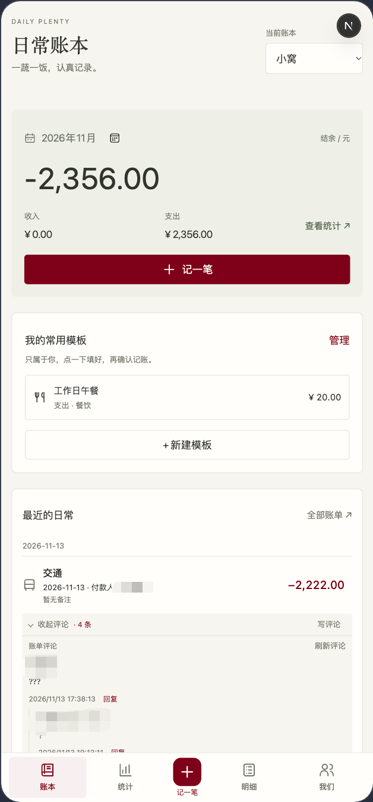
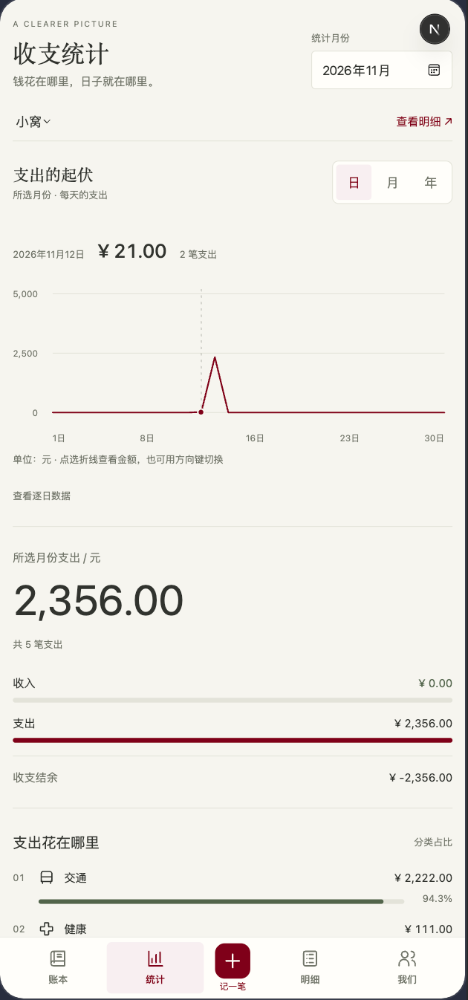
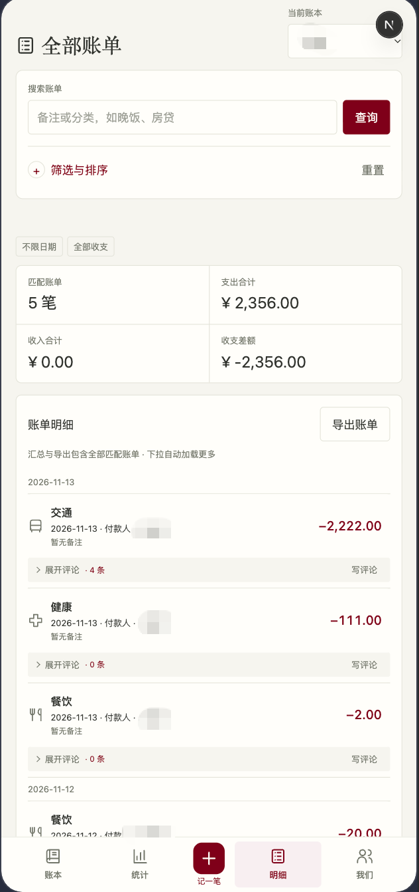
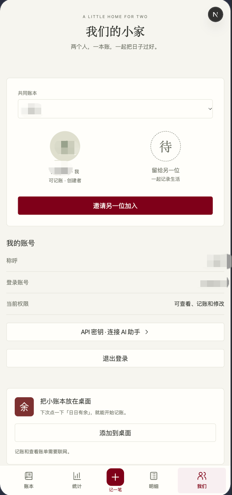
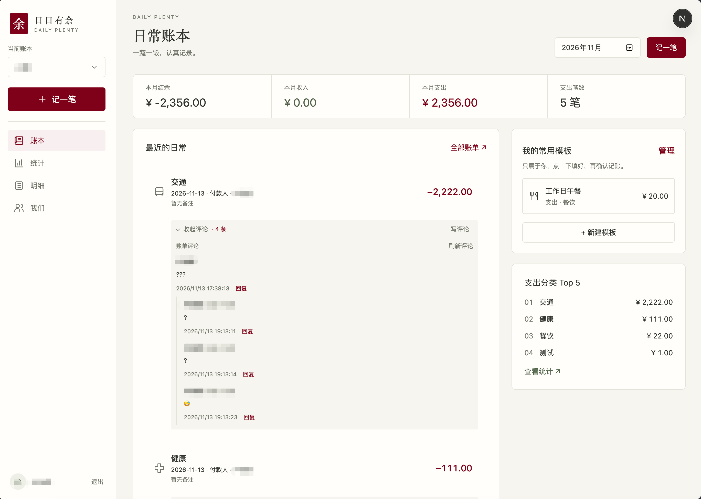
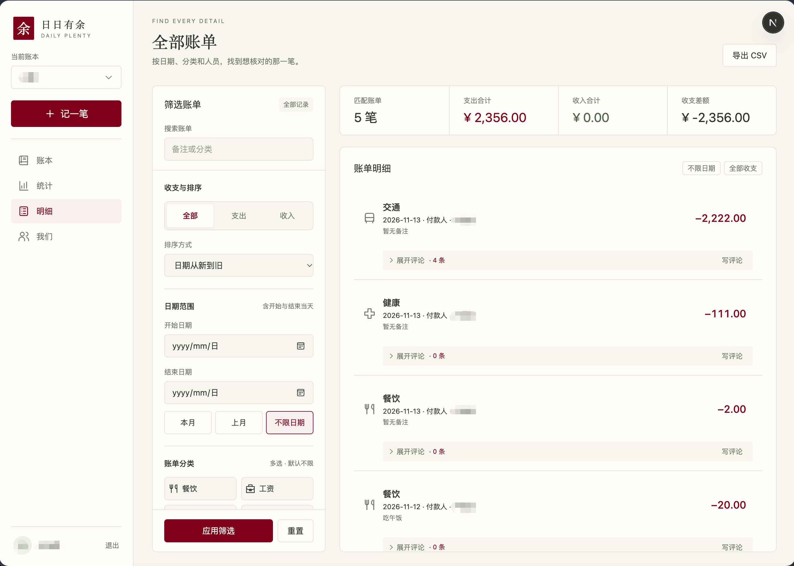
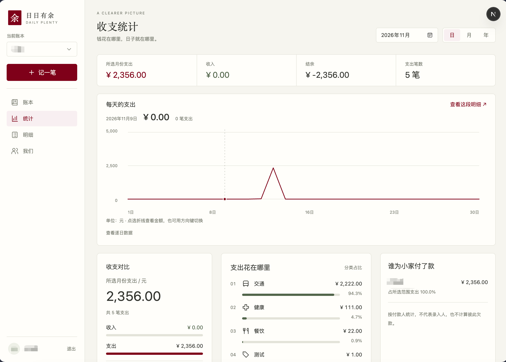
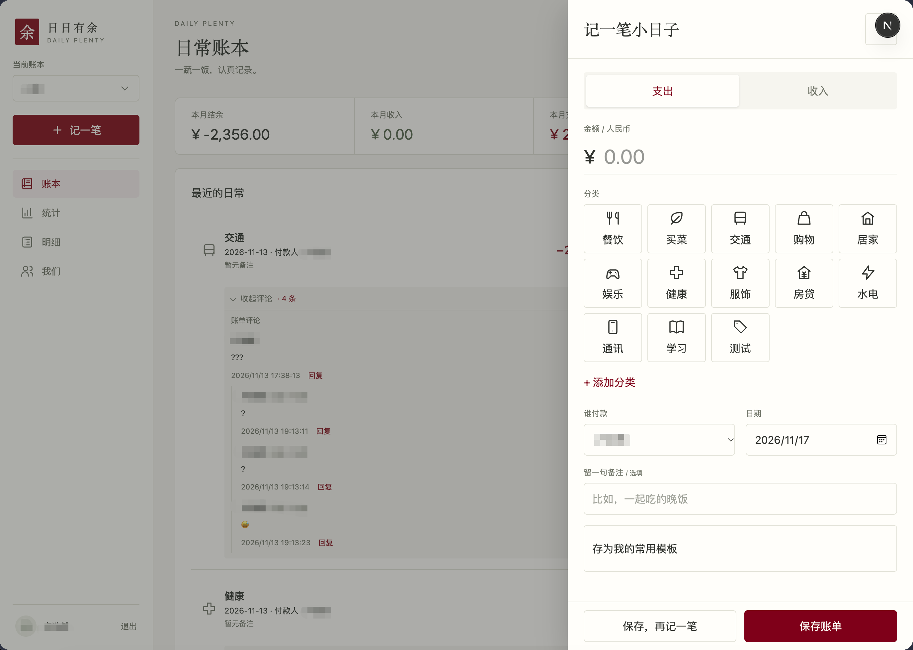

<div align="center">


# 日日有余 · Daily Plenty

**两个人，一本账。**

为伴侣与家庭设计的共享记账网页：双人账本、模板速记、账单评论、多维统计与 CSV 导出。<br />
单个 Node.js 进程 + SQLite，一台 2 GiB 的小服务器即可自部署。


</div>

---

## 截图

<!-- 截图放在 docs/screenshots/，文件名见该目录 README；替换同名文件即可，无需改这里 -->

**手机端**

| 账本                                 | 统计                                    | 明细                                    | 我们                                     |
| ------------------------------------ | --------------------------------------- | --------------------------------------- | ---------------------------------------- |
|  |  |  |  |

**桌面端**



| 明细与筛选                               | 统计                                     |
| ---------------------------------------- | ---------------------------------------- |
|  |  |

| 记一笔                                | 账单评论                               |
| ------------------------------------- | -------------------------------------- |
|  |  |

## 特性

- **双人账本** — 账本所有者生成一次性邀请链接，对方打开即可加入，无需管理员介入。
- **模板速记** — 常用支出存为个人模板，一键填入金额与分类，日期默认今天；模板仅自己可见，本身不产生账单。
- **账单评论** — 每笔账单可展开评论，支持一级平铺回复并保留回复对象，两个人可以就一笔开销持续交流。
- **分类与图标** — 预置 13 个支出、6 个收入分类，可自行新增并从 23 个线条图标中选择。
- **多维统计** — 日 / 月 / 年三档支出折线，同范围收支、分类排名与付款人分布；支持触摸点选与键盘方向键。
- **筛选、排序与导出** — 按日期、金额、分类、付款人、录入人、关键词组合筛选，按时间或金额排序；条件写入 URL 可分享，结果一键导出 CSV（含公式注入防护）。
- **账单安全** — 请求幂等、版本号防覆盖、软删除；删除须选择原因，选"其他"时必须填写说明。
- **双端布局** — ≥1024px 为桌面布局（侧边栏 + 列表优先），其余为手机布局（底部导航），同一套业务逻辑。
- **PWA** — 可添加到桌面；HTTPS 下注册 Service Worker，断网显示离线提示。财务数据从不缓存。

## 页面

| 入口 | 路径        | 内容                                             |
| ---- | ----------- | ------------------------------------------------ |
| 账本 | `/`         | 记一笔、个人模板、最近记录与评论                 |
| 统计 | `/reports`  | 日/月/年支出折线、同范围收支、分类排名、付款分布 |
| 明细 | `/records`  | 高级筛选、排序、无限加载、编辑删除与导出         |
| 我们 | `/together` | 共享成员、一次性邀请、账号与退出、安装到桌面     |

「＋ 记一笔」在任意页面打开同一个录入抽屉（桌面端为右侧面板），保存后就地刷新，不跳转。

## 快速开始

需要 Node.js 22.13+ 与 pnpm：

```bash
git clone https://github.com/geek-lu/daily-plenty.git
cd daily-plenty
pnpm install --frozen-lockfile
pnpm dev
```

打开 <http://127.0.0.1:3000/setup> 创建第一个账号和账本（密码至少 6 位，初始化密钥由服务端自动管理），再到「我们」页生成邀请链接发给另一位成员。

可选：`pnpm configure` 生成 `.env.local`（数据库路径等），只补缺项，不覆盖已有配置。

## 开发

```bash
pnpm format:check        # 格式
pnpm check               # TypeScript 严格类型
pnpm check:architecture  # 分层与 PC/手机互不依赖
pnpm test                # 应用测试
pnpm test:scripts        # 部署与脚本测试
pnpm build               # 生产构建
pnpm check:routes        # 基于构建产物的真实路由检查
```

分层：`UI (pc / m) → common runtime → API → http router → flows / service → repo → SQLite`。金额按整数"分"存储；迁移文件在 `migrations/`，已发布的 SQL 不再修改。更多设计说明见 [docs/DESIGN.md](docs/DESIGN.md)。

```text
src/
├── app/       路由与薄 API 适配
├── features/  common 共用逻辑；pc 桌面端；m 手机端
├── server/    http → flows → user / auth / ledger 服务 → db
├── shared/    类型、金额、日期、分类图标与输入校验
└── ui/        动效、手势与浏览器适配
```

## 部署

面向单台 Linux 服务器（无需域名、Docker 或数据库服务），包含源码打包、低内存构建、systemd 服务与每日备份：

```bash
cp deploy.local.mk.example deploy.local.mk   # 填写服务器 IP / SSH 用户 / 密钥（已 gitignore）
make deploy                                  # 首次：准备环境并发布
make update                                  # 之后：只更新应用
```

支持公网 HTTP、SSH 隧道预览与 HTTPS 反向代理三种访问模式。完整步骤、安全组设置与数据恢复见 [deploy/README.md](deploy/README.md)。

> 公网 HTTP 模式下传输不加密，长期使用建议配置域名与 HTTPS。

## 当前范围

- 仅支持人民币，不自动计算双方欠款。
- 不做银行同步、OCR 或实时推送。
- 数据保存在本地 SQLite（WAL 模式），迁移带哈希校验，支持定期备份。
